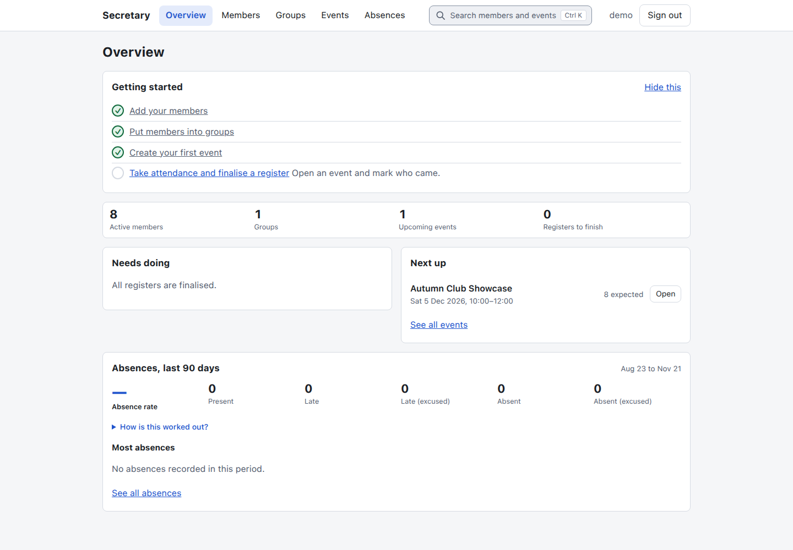

# Secretary

Secretary is a self-hosted app for clubs and societies. It keeps member and group records, schedules events, tracks attendance, and produces absence reports. Secretaries can review messages as evidence before approving register changes, then prepare announcements to copy into Messenger.

## What it does

- Organise members and groups, then add expected attendees to each event.
- Save registers as you take attendance. Finalise or reopen them with a reason, and keep a record of every change.
- Review clipboard or screenshot messages before applying them to a register. Missing messages never count as absences.
- Export member, event, attendance, and absence reports as CSV files.
- Give secretaries, assistants, and viewers the access each role needs.
- Host the app yourself with Docker and SQLite.

## Screenshots

These screenshots use synthetic demo data.

<table>
  <tr>
    <td></td>
    <td></td>
  </tr>
  <tr>
    <td align="center">Overview</td>
    <td align="center">Members</td>
  </tr>
  <tr>
    <td colspan="2"></td>
  </tr>
  <tr>
    <td colspan="2" align="center">Taking attendance</td>
  </tr>
</table>

**Secretaries start with [docs/secretary-guide.md](docs/secretary-guide.md).** To put it on a server, see [docs/deploy.md](docs/deploy.md) (Docker, private on Tailscale or public with HTTPS). The rest of this README is for developers.

Only process content you are authorised to see. The project does not automate Messenger through unsupported interfaces.

## Layout

```
backend/    FastAPI app, SQLite storage, pytest tests
collector/  Clipboard collector script (runs on your own desktop)
frontend/   React + Vite dashboard (the backend serves its build)
```

## Backend

Tested with Python 3.13.

```bash
cd backend
python3 -m venv .venv
. .venv/bin/activate
pip install -r requirements.txt
uvicorn app.main:app --reload
```

The database is created at `backend/data/secretary.db`. Override it with `SECRETARY_DB_PATH`.

Every endpoint except `/health` and the sign-in routes needs credentials. Before first use, create an admin account (see "Sign-in and security"):

```bash
python -m app.admin create-user admin
```

Endpoints (Access: **public**, **admin** = signed-in session cookie, **ingest** = ingest token or admin session):

| Method | Path | Access | Purpose |
|---|---|---|---|
| GET | `/health` | public | Liveness check, including a database query |
| POST | `/auth/login` | public | Sign in with `{"username", "password"}`; sets the session cookie. 401 for wrong credentials, 429 when rate-limited |
| POST | `/auth/logout` | public | End the session and clear the cookie (204; fine when not signed in) |
| GET | `/auth/me` | public | `{"username"}` of the signed-in admin, or 401 |
| POST | `/messages` | ingest | Store one message (`message_text`, `source` = `clipboard` or `ocr`, optional `chat_id`, `sender`, `timestamp`, `confidence`) |
| POST | `/ocr/screenshots` | ingest | Upload a Messenger screenshot (multipart `file`, optional `chat_id`); stores each detected message with `source` = `ocr` |
| GET | `/messages` | admin | List messages, newest first, each with its `sources` and `categories`; optional search and filters (see "Search and filters") |
| GET | `/messages/{id}/variants` | admin | Every extraction recorded for one message (`id`, `source`, `message_text`, `confidence`, `created_at`); 404 if the message does not exist |
| POST | `/rules` | admin | Create a rule (201); see "Rules and notifications" |
| GET | `/rules` | admin | List rules |
| GET | `/rules/{id}` | admin | One rule; 404 if missing |
| PATCH | `/rules/{id}` | admin | Change fields of a rule (merged and re-validated); does not recompute existing matches |
| DELETE | `/rules/{id}` | admin | Delete a rule with its matches and notifications (204) |
| POST | `/rules/{id}/backfill` | admin | Apply the rule to every stored message, without notifications; returns `{"rule_id", "matching_messages"}` |
| GET | `/notifications` | admin | Notifications, newest first (`unread`, `limit`, `before_id`) |
| POST | `/notifications/{id}/read` | admin | Mark one notification read (idempotent) |
| POST | `/notifications/read-all` | admin | Mark every unread notification read; returns `{"marked": n}` |
| GET | `/stats` | admin | Dashboard numbers: `total_messages`, `by_source` (`clipboard`, `ocr`), `by_category` (`category`, `count`; messages per category, highest first), `per_day` (the last 14 UTC days including today, oldest first, zero-filled), `unread_notifications`, `enabled_rules`, `latest_message_at` (or `null`) |
| GET | `/chats` | admin | Every chat id (may be `null`) with its message `count` and `latest_at`, newest activity first |

Run the tests:

```bash
cd backend
python -m pytest -q
```

## Sign-in and security

Nothing is reachable without credentials except `GET /health`, the sign-in routes and the static dashboard files.

**First run.** Create an admin account on the machine that runs the backend (a password of at least 12 characters; you are asked twice, and it is never shown):

```bash
cd backend
python -m app.admin create-user admin
```

`--password-stdin` reads one line from standard input instead, for scripts. `python -m app.admin set-password USERNAME` changes a password and signs that admin out everywhere. All commands take `--db PATH` (default `SECRETARY_DB_PATH` or `data/secretary.db`) and report errors on stderr with exit code 1.

**Roles.**

| Credential | Can reach |
|---|---|
| none | `GET /health`, `POST /auth/login`, `POST /auth/logout`, `GET /auth/me` (401 until signed in), the static dashboard |
| ingest token (`Authorization: Bearer ...`) | only `POST /messages` and `POST /ocr/screenshots` |
| admin session (cookie) | everything, including ingest |

**Sessions.** `POST /auth/login` sets the cookie `secretary_session`: random, stored on the server only as a SHA-256 digest, valid for 12 hours from sign-in (it does not extend), `HttpOnly`, `SameSite=Strict`, `Path=/`. Passwords are stored as scrypt hashes (`scrypt$16384$8$1$salt$hash`). Behind HTTPS, set `SECRETARY_COOKIE_SECURE=1` so the cookie also gets the `Secure` flag (it is off by default so that `http://localhost` works).

**Cross-site requests.** A request that is authenticated by the cookie and is not `GET`, `HEAD` or `OPTIONS` must send the header `X-Requested-With: secretary`, otherwise it gets 403. `POST /auth/login` and `/auth/logout` need it too. Bearer-token requests are exempt. There is no CORS: the dashboard is served from the same origin as the API.

**Rate limit.** After 5 failed sign-ins for one client IP, or for one username (compared in lower case), further attempts get 429 with a `Retry-After` header (seconds) until the 15-minute sliding window has cleared. A successful sign-in clears that username's failures. The counters are in memory: they reset when the server restarts, and behind a reverse proxy every client shares the proxy's IP address, so the per-IP limit then applies to everyone together.

**Ingest tokens** let the clipboard collector (or a script) store messages without an admin password. Create one per client:

```bash
cd backend
python -m app.admin create-token my-desktop    # prints st_... once; it is not stored and cannot be shown again
python -m app.admin list-tokens                # id, name, scope, created_at, last_used_at, revoked
python -m app.admin revoke-token 1             # takes effect immediately
```

Only a SHA-256 digest of the token is stored. A revoked token is rejected with 401, and `last_used_at` shows whether a token is still in use, so revoke tokens that are lost or no longer needed. Give the token to the collector as described under "Clipboard collector".

**Security headers.** Every response carries `X-Content-Type-Options: nosniff`, `X-Frame-Options: DENY`, `Referrer-Policy: no-referrer` and a `Content-Security-Policy` that only allows the page's own scripts and styles. The interactive API docs (`/docs`, `/openapi.json`) are switched off because they would be public pages.

**Serving the dashboard.** If `frontend/dist` exists (run `npm run build`), the backend serves it at `/`; set `SECRETARY_FRONTEND_DIST` to use another directory. API routes always take precedence. Without the directory only the API is served.

**Idempotency-Key (safe retries).** A `POST` (outside `/auth/`) may carry an `Idempotency-Key` header, 1 to 128 characters of `A-Z a-z 0-9 _ -` (a UUID works). If the connection drops and the same request is sent again with the same key, the backend returns the first response (same status, body and content type, plus `Idempotent-Replayed: true`) instead of creating a duplicate. Requests without the header, and `PUT`, `PATCH` and `DELETE`, behave as before.

- Keys are scoped to the caller: the signed-in admin for session callers, the API token for ingest-token callers. Two callers can use the same key without seeing each other's responses. Unauthenticated requests are never stored, and a replay needs the same sign-in and `X-Requested-With` header as the original.
- A key belongs to one method, path (with query string) and body. Reusing it for something different returns 422 `This Idempotency-Key was already used for a different request`. Resend the identical bytes when retrying; for a multipart upload that means the same body and boundary.
- While the first request is still running, a repeat returns 409 `A request with this Idempotency-Key is still in progress`. An invalid key returns 400 `Invalid Idempotency-Key`.
- Only 2xx and 4xx responses up to 1 MB are stored (not 5xx, 401, 403 or 429); after a failure the same key can be retried and runs again. Bodies larger than the upload limit skip the feature.
- Stored responses are kept for 24 hours (table `idempotency_keys`, purged as new keys arrive).
- The dashboard sends the header automatically on create requests.

**Using the API with curl.** Sign in once into a cookie jar, then send the cookie, and the `X-Requested-With` header on every request that changes data:

```bash
curl -c cookies.txt -H 'X-Requested-With: secretary' -H 'Content-Type: application/json' \
  -d '{"username": "admin", "password": "your password"}' http://127.0.0.1:8000/auth/login
curl -b cookies.txt http://127.0.0.1:8000/auth/me
curl -b cookies.txt -H 'X-Requested-With: secretary' -X POST http://127.0.0.1:8000/auth/logout
```

An ingest script can use a Bearer token instead, with no cookie and no extra header:

```bash
curl -H "Authorization: Bearer $SECRETARY_TOKEN" -H 'Content-Type: application/json' \
  -d '{"message_text": "Meet at 6pm", "source": "clipboard", "chat_id": "my-group"}' http://127.0.0.1:8000/messages
```

The curl examples below use `-b cookies.txt`, plus the header on writes. Plain HTTP is fine on localhost; for any other access put the backend behind HTTPS (a reverse proxy) so passwords and cookies are not sent in clear text.

## Search and filters

`GET /messages` always returns a JSON list ordered by `id` descending. All parameters are optional and are combined with AND.

| Parameter | Meaning |
|---|---|
| `q` | Full-text search, 1–200 characters. Words are matched case-insensitively and ignoring accents, and each word matches as a prefix (`meet` finds `meeting`, `cafe` finds `café`). Several words must all be present. Punctuation and search operators are ignored, so `q` is only ever treated as words; a `q` with no letter or digit returns 422. At most the first 20 words are used. |
| `chat_id` | Exact chat id (max 200 characters) |
| `sender` | Exact sender (max 200 characters) |
| `source` | `clipboard` or `ocr` |
| `category` | Only messages matched by a rule with this exact category (max 50 characters) |
| `since` | Only messages stored at or after this time (ISO 8601 datetime, for example `2024-01-31T09:00:00Z`; no offset means UTC) |
| `until` | Only messages stored before this time (same format); `since` must be earlier than `until`, otherwise 422 |
| `before_id` | Only messages with an `id` below this value (at least 1). To page, pass the last `id` of the previous page |
| `limit` | Page size, 1–500, default 50 |

Times compare against `created_at`, the moment the message was first stored (UTC). In a URL, write a `+` in an offset as `%2B`.

```bash
curl -b cookies.txt "http://127.0.0.1:8000/messages?q=meeting&chat_id=my-group&source=clipboard&limit=20"
curl -b cookies.txt "http://127.0.0.1:8000/messages?limit=20&before_id=120"   # next page
```

## Rules and notifications

Rules detect keywords and predefined patterns in stored messages, tag them with a category and can create in-app notifications. Every message goes through the rules once it is stored (see `backend/app/rules.py`).

A rule has a `name` (1-100 characters), a `kind`, an optional `category` (1-50 characters), `notify` (default `false`), `enabled` (default `true`) and an optional `chat_id` (the rule only applies in that chat; without it, in every chat).

**Keyword rules** (`kind` = `keyword`) take `keywords`, 1-50 phrases of up to 100 characters, each with at least one letter or digit. A phrase matches whole words only, ignoring case, accents and punctuation: `meet` does not match `meeting`, `cafe` matches `Café`, and `see you` matches `Sige, see you mamaya`. A rule matches when any of its phrases does; the first matching phrase is recorded as `matched_text`.

**Pattern rules** (`kind` = `pattern`) take `pattern`, one of six built-in detectors:

| Pattern | Matches, for example |
|---|---|
| `url` | `https://example.com/a`, `www.example.com` |
| `email` | `juan@example.com` |
| `phone` | `0917 123 4567`, `+63 917 123 4567`, `09171234567` (10-15 digits; dates such as `2026-11-19` are not phones) |
| `money` | `₱1,500`, `PHP 200`, `P50`, `$12.50`, `300 pesos` (not `6pm`) |
| `time` | `6pm`, `6:30pm`, `18:30`, `9:05 AM` |
| `date` | `2026-11-19`, `11/19`, `11/19/2026`, `Nov 19`, `November 19` |

Keywords are required for keyword rules and rejected for pattern rules; `pattern` is the other way round. Patterns are simple heuristics: `1/2` reads as a date and `may 5` matches even in a sentence.

**Categories.** A matching rule with a `category` adds it to the message. `GET /messages` returns each message's sorted `categories` and accepts `?category=` as a filter. `POST /messages` and each OCR item report `categories` too.

**Notifications.** A message that newly matches a rule with `notify` set creates one notification (at most one per rule and message). A duplicate of a message does not create a second one, and a notification never disappears when the message is re-evaluated; it is history. `GET /notifications` lists them newest first with the rule name and message text; `?unread=true` or `false` filters, `limit` is 1-500 (default 50) and `before_id` pages.

**Text corrections.** A message is re-evaluated whenever it is stored, and whenever its text changes: clipboard text replacing an OCR reading, or a higher-confidence OCR reading. An OCR misread such as `chalrs` does not match the keyword `chairs`; when the clipboard copy `chairs` is merged in, the message matches and the notification fires. If the replaced text no longer matches, the match (and category) is removed; its notification stays.

**Backfill.** A new rule only sees messages stored after it was created. `POST /rules/{id}/backfill` applies it to every stored message and returns how many match. Backfill never creates notifications. Only that rule's matches change; a disabled rule matches nothing, so backfilling it clears its tags, and a rule with a `chat_id` only tags messages in that chat.

**Editing and deleting.** `PATCH /rules/{id}` takes any of the fields, merges them into the stored rule and validates the result. It does not recompute existing matches: run backfill afterwards. When you change `kind`, null out the other kind's field: `{"kind": "pattern", "pattern": "url", "keywords": null}`. Disabling a rule (`"enabled": false`) stops new matches and keeps its history. `DELETE /rules/{id}` removes the rule together with its matches and notifications; disable the rule instead if you want to keep them.

```bash
W='-b cookies.txt -H X-Requested-With:secretary'   # cookie jar from the sign-in above; the header is needed on writes
curl $W -X POST http://127.0.0.1:8000/rules -H 'Content-Type: application/json' \
  -d '{"name": "Chairs", "kind": "keyword", "keywords": ["chairs", "tables"], "category": "setup", "notify": true}'
curl $W -X POST http://127.0.0.1:8000/rules -H 'Content-Type: application/json' \
  -d '{"name": "Phone numbers", "kind": "pattern", "pattern": "phone", "category": "contact"}'
curl $W -X POST http://127.0.0.1:8000/rules/1/backfill
curl $W -X PATCH http://127.0.0.1:8000/rules/1 -H 'Content-Type: application/json' -d '{"enabled": false}'
curl -b cookies.txt "http://127.0.0.1:8000/messages?category=setup"
curl -b cookies.txt "http://127.0.0.1:8000/notifications?unread=true&limit=20"
curl $W -X POST http://127.0.0.1:8000/notifications/3/read
curl $W -X POST http://127.0.0.1:8000/notifications/read-all
curl $W -X DELETE http://127.0.0.1:8000/rules/1
```

There are still deliberately no custom regular expressions (a pattern that takes exponential time could freeze the server), no outbound webhooks and no email. Sign-in now makes them possible; they are future work and need their own safeguards (a regex time limit, an allow-list for webhook targets, mail credentials kept out of the database).

## Members and groups

Roles: anyone signed in can read; the secretary and the assistant can add and edit; only the secretary can deactivate a member, delete a group or import. Members are never deleted. Group names are unique (case-insensitive) and `member_code` is unique when set.

| Method | Path | Role | Purpose |
|---|---|---|---|
| GET | `/members` | any | List members (max 1000, by name). Filters: `q` (substring of name, email, phone or code), `group_id`, `active` (`true`/`false`). Each member has `group_ids` |
| POST | `/members` | secretary, assistant | Create (201). Fields: `full_name` (required), `email`, `phone`, `member_code`, `notes`, `joined_on`, `left_on` (`YYYY-MM-DD`), `active` |
| GET / PATCH | `/members/{id}` | any / secretary, assistant | Read, or change any field; changing `active` needs the secretary (403 otherwise) |
| PUT | `/members/{id}/groups` | secretary, assistant | Replace the member's groups: `{"group_ids": [1, 2]}` |
| GET / POST | `/groups` | any / secretary, assistant | List (with `member_count`) or create (`name`, `description`) |
| PATCH / DELETE | `/groups/{id}` | secretary, assistant / secretary | Edit; delete a group (204, memberships only) |
| POST | `/members/import/preview` | secretary | Upload a CSV (multipart field `file`, max 10 MB, 5000 rows); writes nothing. Returns per-row `data`, `errors` and `duplicates` |
| POST | `/members/import/confirm` | secretary | `{"rows": [{"data": {...}, "action": "create" \| "update" \| "skip", "member_id": 3}]}`; re-validated, all-or-nothing. Returns `{created, updated, skipped}` |

CSV columns (headers are case-insensitive, spaces count as underscores, other columns are ignored): `full_name` (or `name`; required), `email`, `phone`, `member_code`, `notes`, `joined_on`, `left_on`, `groups` (names separated by `;`; unknown groups are created and members are added to them). Save from Excel as "CSV UTF-8". A row is a duplicate candidate when `member_code` or email matches, or the phone digits (at least 7) or the full name match, against existing members or earlier rows in the same file. An `update` only fills fields that are not empty in the row.

## Events

Roles: anyone signed in can read; the secretary and the assistant can create, edit, duplicate and manage expected attendees; only the secretary can delete an event (draft only). Times (`starts_at`, `ends_at`) are local wall-clock strings like `2025-03-31T18:30`, with no time zone; `ends_at` is optional but cannot be before `starts_at`.

Lifecycle: `draft` -> `scheduled` -> `completed`, and a draft or scheduled event can be `cancelled`. Any other status change answers 409. New events are created as `draft` (default) or `scheduled`. Completed and cancelled events are locked: only `notes` can change and the expected list cannot be edited. Expected attendees are a snapshot: adding a group adds its active members at that moment as individual rows, and later group changes do not alter the event.

| Method | Path | Role | Purpose |
|---|---|---|---|
| GET | `/events` | any | List (max 1000, by start time). Filters: `q` (substring of name, location or category), `status`, `category` (exact), `date_from`, `date_to` (`YYYY-MM-DD`, inclusive). Each event has `expected_count` |
| POST | `/events` | secretary, assistant | Create (201). Fields: `name` (required), `starts_at` (required), `ends_at`, `location`, `category`, `notes`, `status` (`draft` or `scheduled`) |
| GET / PATCH | `/events/{id}` | any / secretary, assistant | Read with `attendees`, or change any field including `status` |
| POST | `/events/{id}/duplicate` | secretary, assistant | Copy with its expected attendees as a new draft (201) |
| DELETE | `/events/{id}` | secretary | Delete a draft event (204); other statuses answer 409, cancel them instead |
| POST | `/events/{id}/attendees` | secretary, assistant | `{"member_ids": [1, 2], "group_ids": [3]}` (at least one, max 5000 each). Inactive or unknown members and unknown groups answer 422; members already on the list are ignored. Returns `{added, event}` |
| DELETE | `/events/{id}/attendees/{member_id}` | secretary, assistant | Remove one expected attendee (204) |
| GET | `/categories` | any | Distinct event categories in use, sorted |

## Attendance and absences

Each expected person has one status: `not_recorded` (default), `present`, `late`, `absent` or `excused`. The secretary and the assistant record attendance on scheduled or completed events and can save part-way. Only the secretary finalises a register, which needs everyone recorded and marks the event completed, or reopens it, which needs a reason. Every status change, finalise and reopen is kept in `attendance_audit` with who, when, the old and new status and any reason.

**Absence rule (D9):** only finalised registers of events that weren't cancelled count. Absence rate = absent ÷ (present + late + absent); excused is shown but isn't in the rate, and a member with no present, late or absent has no rate (`null`). A member only counts for events they were expected at.

| Method | Path | Role | Purpose |
|---|---|---|---|
| PUT | `/events/{id}/attendance` | secretary, assistant | `{"records": [{"member_id": 1, "status": "present"}], "reason": "optional"}`. 409 for draft or cancelled events and finalised registers |
| POST | `/events/{id}/finalize` | secretary | Lock the register (409 if anyone is not recorded or the list is empty) |
| POST | `/events/{id}/reopen` | secretary | `{"reason": "..."}` (required) |
| GET | `/events/{id}/audit` | any | Change history, newest first |
| GET | `/absences` | any | Per member over counted events, most absences first. Filters: `date_from`, `date_to`, `group_id`, `active` |
| GET | `/members/{id}/attendance` | any | A member's totals and every event they were expected at, with `counted` showing which rows make up the totals |
| GET | `/dashboard` | any | Member and group counts, upcoming events, registers still to finish, and absences over the last 90 days |

## Message evidence review

Messages are only evidence: nothing changes a register until the secretary approves, and a missing message never means someone was absent. The review queue lists recent messages (the newest 2000 are scanned) that mention attendance, such as "running late", "apologies, can't make it" or "I'm here". For each one it suggests a person (the sender's name matches exactly one active member), an event (one on or up to a week after the message's date, preferring one the person is expected at, or the day before) and a status, and says why. Suggestions are worked out when the queue is read and never stored.

Approving sets that person's status through the same audited path as the register, with the message linked in the change history (`attendance_audit.evidence_id`). A finalised register is never changed: reopen it first. Rejecting changes nothing. Either decision is kept in `evidence_reviews` with the message text as it was reviewed. Secretary only.

| Method | Path | Purpose |
|---|---|---|
| GET | `/evidence?state=pending\|approved\|rejected` | The queue (max 200, newest first) with suggestions and any decision |
| POST | `/evidence/{message_id}/approve` | `{"member_id", "event_id", "status", "note"}`. 409 if already reviewed, the event is draft or cancelled, or the register is finalised; 422 if the person isn't expected |
| POST | `/evidence/{message_id}/reject` | `{"note"}` (optional) |

## Reports and exports

Every report downloads as a CSV file that opens in Excel (UTF-8 with a byte-order mark, so accented names survive). Each one starts with its title, when it was generated (server time), the filters and period it covers and, for absence figures, the counting rule. It ends with totals. Downloads use the same filters and calculations as the screens, without the screens' 1000-row limits. Any signed-in role can download. A cell starting with `=`, `+`, `-` or `@` is prefixed with `'` so a spreadsheet never runs imported text as a formula.

| Path | Report | Filters |
|---|---|---|
| `/exports/members.csv` | Member list with groups | `q`, `group_id`, `active` |
| `/exports/events.csv` | Event summary: expected and each status per event (raw counts, cancelled events included, with each event's status shown) | `q`, `status`, `category`, `date_from`, `date_to` |
| `/exports/events/{id}/register.csv` | Attendance sheet for one event, saying whether the register is finalised | |
| `/exports/absences.csv` | Absence report (rule D9) with overall totals | `date_from`, `date_to`, `group_id`, `active` |
| `/exports/members/{id}/attendance.csv` | One member's history, marking which events count | |

## Backups

`backend/app/backup.py` takes a consistent copy of the database using SQLite's online backup, so it is safe while the server is running. Uncommitted writes are not included. The copy is written to a temporary `.partial` file, checked with `PRAGMA integrity_check`, and only then renamed to `secretary-YYYYMMDDTHHMMSS-ffffffZ.db` (UTC). Afterwards only the newest `--keep` files named `secretary-*.db` in the backup directory are kept; other files are never touched.

```bash
cd backend
python -m app.backup                                   # data/secretary.db -> backups/
python -m app.backup --db data/secretary.db --dir backups --keep 14
```

Defaults: `--db` is `SECRETARY_DB_PATH` or `data/secretary.db`, `--dir` is `backups` (ignored by git), `--keep` is 14. On success it prints the backup path; on failure it prints one line to stderr and exits with code 1 (a missing database is an error; no empty database is created).

Daily at 02:00 with cron (use absolute paths):

```cron
0 2 * * * cd /path/to/secretaryapp/backend && .venv/bin/python -m app.backup --dir /path/to/backups
```

Daily at 02:00 with Windows Task Scheduler:

```bat
schtasks /Create /SC DAILY /ST 02:00 /TN "SecretaryBackup" /TR "cmd /c cd /d C:\secretaryapp\backend && .venv\Scripts\python.exe -m app.backup --dir C:\secretaryapp\backups"
```

There is deliberately no HTTP endpoint for backups. Backups contain every stored message, and the password hashes and token digests, so keep the backup directory private and copy it off the machine as well.

Restore:

1. Stop the server.
2. Keep the current database in case you need it: `mv data/secretary.db data/secretary.db.before-restore`.
3. Delete any `secretary.db-journal`, `secretary.db-wal` or `secretary.db-shm` files next to it. A leftover journal from a crash would otherwise be replayed onto the restored copy and corrupt it.
4. Copy the chosen backup into place: `cp backups/secretary-20240131T020000-000000Z.db data/secretary.db`.
5. Start the server again. Older backups are migrated automatically on start-up.

## How messages are merged

Clipboard and OCR both go through one pipeline (`backend/app/pipeline.py`), so the same chat message seen twice is stored once. An incoming message is compared with stored messages of the same `chat_id`, in three tiers. Sender and timestamp must be compatible: equal, or missing on either side.

1. **exact**: same chat, sender, timestamp and text.
2. **normalised**: same text after ignoring case, punctuation, spaces and Unicode width (`Meet at 6pm, ok?` matches `meet at 6pm ok`).
3. **fuzzy**: a close match (similarity of 0.9 or more) among the 500 newest messages in the chat. This absorbs OCR misreads such as `chairs` read as `chalrs`.

Safety rules (merging two different messages would hide one, so the rules lean towards keeping both):

- Clipboard text is exact, so two clipboard messages only merge when identical; `See you there?` and `See you there.` stay separate.
- Fuzzy matches need identical digits in both texts (`6pm` and `7pm` stay separate messages).
- Fuzzy matches need at least half the words in common and at least 12 letters and digits in each text; shorter messages only match exactly or after normalising.

When a message matches, no row is deleted. Clipboard text replaces OCR text (the row becomes `source` = `clipboard`, confidence cleared). Between two OCR readings, the one with the higher confidence wins. Otherwise the stored row is kept. Every extraction, whichever way it ended up, is kept in the `message_variants` table (see `GET /messages/{id}/variants`), and the stored message lists the distinct `sources` that have seen it. `POST /messages` and each item from `POST /ocr/screenshots` report `match` (`exact`, `normalised`, `fuzzy` or `null`); `duplicate` is true whenever `match` is not null.

## OCR screenshots

`POST /ocr/screenshots` takes a Messenger screenshot (multipart `file`: a PNG or JPEG of at most 10 MB, 25 megapixels and 10,000 px per side, checked from the file header before any decoding; plus an optional `chat_id`), runs OCR, groups the text lines into chat bubbles and stores each bubble as a message with `source` = `ocr` and the OCR confidence. Re-uploading the same screenshot does not add rows; those messages come back with `duplicate: true`, and text that was also copied from the clipboard is merged into the same message (see "How messages are merged"). The response lists the stored messages (with `side`, `left` or `right`), `skipped_lines` (centred text such as timestamps and system notices) and `rejected` (bubbles that failed validation).

```bash
curl -H "Authorization: Bearer $SECRETARY_TOKEN" -F file=@shot.png -F chat_id=my-group http://127.0.0.1:8000/ocr/screenshots
```

Crop screenshots to the conversation area first: the header and the input bar would be read as messages.

The OCR engine (PaddleOCR) is an optional heavy install, about 1.2 GB, and it downloads its models on first use:

```bash
cd backend
pip install -r requirements-ocr.txt
```

Without it the endpoint returns 503 ("OCR engine not installed; see README"). Models download from Hugging Face by default; if that is blocked, set `PADDLE_PDX_MODEL_SOURCE=bos` to use Paddle's own host (`paddle-model-ecology.bj.bcebos.com`). On CPU a screenshot takes about 2–6 seconds.

Lines are grouped by the bubble they sit in: the bubble's background colour is traced with OpenCV, so a message with blank lines stays one message, and a blank line inside a bubble comes back as `\n\n`. The bubble also decides the side, so the short last line of your own (right) message stays with it. Only short centred text on the page background, outside any bubble, is skipped as a timestamp or notice. This works in light and dark mode. Text without a bubble falls back to line spacing. Sender names and timestamps are not extracted yet.

The real-engine test (`tests/test_ocr_paddle.py`) runs only when the OCR install is present.

### Accuracy

`backend/eval/ocr_eval.py` renders 32 synthetic Messenger-style screenshots (light and dark, PNG and JPEG, English and Taglish) with known text, runs the real pipeline and writes [`docs/ocr-eval.md`](docs/ocr-eval.md). Latest run: 32/32 screenshots grouped correctly, character error rate 0.03%, 97% of messages exact, all paragraph breaks and timestamps handled. Synthetic data is an optimistic upper bound; real screenshots are needed before relying on these numbers.

```bash
cd backend
python -m eval.ocr_eval   # about 3 minutes; needs requirements-ocr.txt
```

## Database changes

All changes are applied automatically on start-up; existing databases are migrated in place.

- v0.2 (Sprint 2): `messages.content_hash` column and its unique index `idx_messages_content_hash`.
- v0.3 (Sprint 4): `messages.match_key` column and index `idx_messages_chat_match (chat_id, match_key)`; new `message_variants` table. Existing rows get `match_key` computed, and one variant each from their current text and source.

- v0.4 (Sprint 5): full-text search. `messages_fts` is an FTS5 external-content index over `messages.message_text` (tokenizer `unicode61 remove_diacritics 2`), kept in sync by the triggers `messages_fts_ai`, `messages_fts_ad` and `messages_fts_au`, so text that is replaced when clipboard text upgrades an OCR reading is re-indexed too. If the index did not exist at start-up, it is rebuilt from the existing rows once (`INSERT INTO messages_fts(messages_fts) VALUES ('rebuild')`). New indexes `idx_messages_created (created_at)` and `idx_messages_chat_id (chat_id, id)` serve the list filters.

- v0.5 (Sprint 6): new tables `rules`, `message_matches` (unique per message and rule, index `idx_matches_rule`) and `notifications` (unique per rule and message, index `idx_notifications_unread (read_at, id)`). Created on start-up if missing; existing messages are not tagged until you run a rule's backfill.

- v0.6 (Sprint 7): new tables `admins` (unique `username`, scrypt `password_hash`), `sessions` (primary key `token_hash`, a SHA-256 digest; `admin_id`, `expires_at`) and `api_tokens` (`name`, unique `token_hash`, `scope` limited to `ingest`, `created_at`, `last_used_at`, `revoked_at`). Created on start-up if missing; existing data is untouched, but the API now needs an admin (`python -m app.admin create-user`) before anything but `/health` can be used.

- v0.7 (Sprint 8): foreign keys are enforced on every connection (`PRAGMA foreign_keys = ON`), and connections are always closed. New index `idx_messages_source (source)`; `idx_matches_rule` is replaced by the covering index `idx_matches_rule_message (rule_id, message_id)`. Both serve `/stats`.

- v0.9 (Phase 1): new tables `members` (unique optional `member_code`), `groups` (unique `name`, case-insensitive) and `member_groups`. Created on start-up if missing.

- v0.10 (Phase 2): new tables `events` (`status` limited to draft, scheduled, completed, cancelled; index `idx_events_starts_at`) and `event_attendees` (primary key `event_id, member_id`; cascades when an event is deleted). Created on start-up if missing.

- v0.11 (Phase 3): `event_attendees` gains `status`, `recorded_at` and `recorded_by`; `events` gains `finalized_at` and `finalized_by`; new table `attendance_audit` (index `idx_attendance_audit_event`). Existing expected attendees start as `not_recorded`.
- v0.12 (Phase 5): new table `evidence_reviews` (one decision per message); `attendance_audit` gains `evidence_id`.
- Idempotency-Key: new table `idempotency_keys` (primary key `scope, key`; index `idx_idempotency_created`). Created on start-up if missing.

## Frontend

Requires Node.js 22 or newer and the backend running on port 8000.

```bash
cd frontend
npm install
npm run dev      # http://localhost:5173, API paths are proxied to the backend
npm run build    # production build in dist/
```

Set `BACKEND_URL` to point the dev proxy at a different backend. Sign in with the account from `python -m app.admin create-user`. After `npm run build`, the backend itself serves the dashboard at `http://127.0.0.1:8000/` (see "Sign-in and security"), so no separate web server is needed.

The dashboard includes Overview, Members, Groups, Events, Announcements, Absences, and Review. Secretaries also have message collection, notifications, and rules when those features are enabled. Available pages depend on the signed-in role.

## Clipboard collector

A small script that runs on your own desktop (never inside the backend). It watches the clipboard and posts each newly copied text to `POST /messages` with `source` = `clipboard` (and your `--chat-id`, if given).

```bash
cd collector
python3 -m venv .venv
. .venv/bin/activate
pip install -r requirements.txt
export SECRETARY_TOKEN=st_...        # an ingest token, see below
python clipboard_collector.py --api-url http://127.0.0.1:8000 --chat-id my-group --interval 1.0
```

All options are optional; defaults are `http://127.0.0.1:8000` and 1 second. Press Ctrl+C to stop.

**Token.** The collector sends `Authorization: Bearer <token>` with every message. Create the token on the backend machine with `python -m app.admin create-token my-desktop` (it is printed once), then give it to the collector in the environment variable `SECRETARY_TOKEN` or in a file with `--token-file PATH` (the first line is used; keep the file readable only by you). There is deliberately no `--token` argument, because command lines end up in shell history and process lists. Without a token the collector exits with an error (code 2). Use `https://` for any backend that is not on your own machine, or the token travels in clear text.

**Heartbeat.** Once a minute the collector also calls `POST /collector/heartbeat` with its token, so the secretary's Overview can show it as online, or offline after 5 minutes of silence (`GET /collector/status`, secretary only). A failed heartbeat is only logged; a 401 or 403 stops the collector like a rejected message does. Attendance never depends on the collector.

**Errors.** If the backend answers 401 or 403, the token is wrong, revoked or lacks access: the collector logs "token rejected; check SECRETARY_TOKEN", exits with code 2 and does not treat that text as sent. If the backend is unreachable or returns a 5xx error, the same text is retried on the next poll; any other 4xx rejection (for example text over 10,000 characters) is logged and not retried. Text already on the clipboard when the script starts is not sent.

It only sends text that you copy, and it does not log message contents (only length, id and duplicate flag). **While it runs, everything you copy is sent**, so stop it before copying passwords or other private text. The token only allows storing messages, but only point the collector at a backend you trust, since it receives everything you copy.

Run the tests (no clipboard or `pyperclip` needed):

```bash
cd collector
pip install pytest
python -m pytest -q
```
