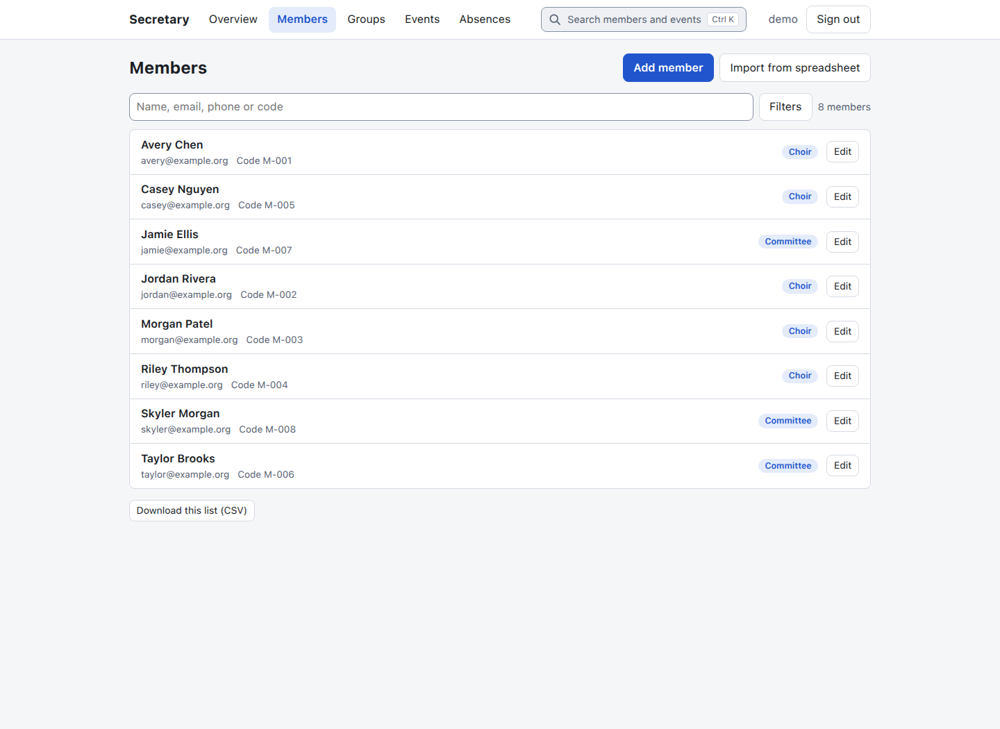
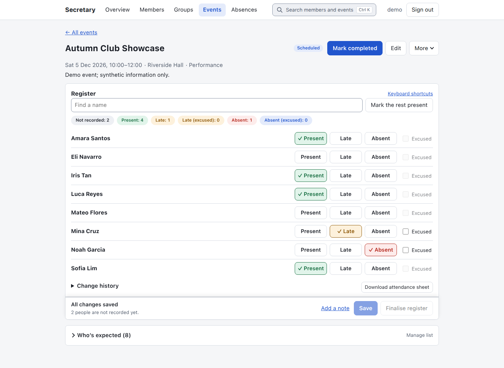

# Secretary

**A self-hosted attendance and event app for clubs and societies.** Keep member records, schedule events, take registers, and track absences in one place. Secretaries review message suggestions before they can change attendance. Only collect messages you are authorized to access; the app does not automate Messenger.

[](https://github.com/kishikai/secretaryapp/releases)
[](LICENSE)

## What you can do

- Manage members, groups, events, and expected attendees.
- Record attendance, save progress, and finalise or reopen registers with an audit trail.
- Review absence figures and download CSV reports.
- Assign secretary, assistant, and viewer roles.
- Collect messages from a clipboard or Messenger screenshots as optional evidence. A secretary approves each suggestion before it changes a register.
- Prepare announcements to copy and send yourself.

## Screenshots

The screenshots use synthetic demo data.

<table>
  <tr>
    <td></td>
    <td></td>
  </tr>
  <tr>
    <td align="center">Overview</td>
    <td align="center">Members</td>
  </tr>
  <tr>
    <td colspan="2"></td>
  </tr>
  <tr>
    <td colspan="2" align="center">Taking attendance</td>
  </tr>
</table>

## Deploy it yourself

Secretary runs in Docker. For a public deployment, you need a server with Docker Compose, a domain pointed at that server, and ports 80 and 443 open. Caddy handles HTTPS.

```bash
git clone https://github.com/kishikai/secretaryapp.git
cd secretaryapp
cp .env.example .env
```

Set `SITE_ADDRESS` in `.env` to your domain, then start the app and create the first secretary account:

```bash
docker compose up -d --build
docker compose exec app python -m app.admin create-user yourname --role secretary
```

Open `https://your.domain` and sign in. For a private deployment on Tailscale, backups, updates, and restore steps, see the [deployment guide](docs/deploy.md).

## For secretaries

The [secretary guide](docs/secretary-guide.md) covers importing members, taking attendance, reviewing message evidence, and downloading reports.

## For developers

The app uses FastAPI, SQLite, React, and Vite. The backend also serves the built dashboard. See the [developer and API reference](docs/development.md) for local setup, API details, tests, the clipboard collector, and OCR.

## License

[MIT](LICENSE)

Maintained by [kishikai](https://github.com/kishikai). Found a problem? [Open an issue](https://github.com/kishikai/secretaryapp/issues).
